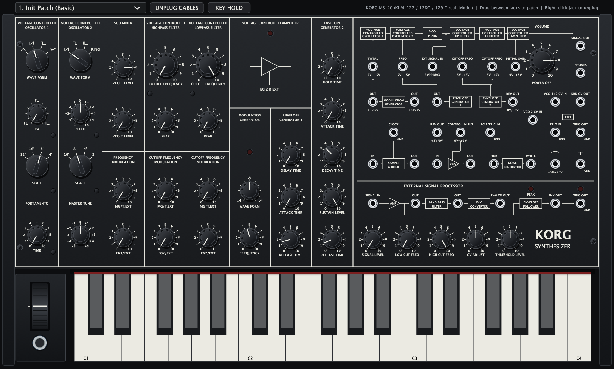

# Korg MS-20 Circuit-Modeled Software Synthesizer (AUv3 / AU / VST3 / Standalone)

A component-level circuit-modeled software synthesizer recreation of the classic 1978 **Korg MS-20** monophonic semi-modular analog synthesizer, built with C++20 and JUCE 8 from the original Korg MS-20 Service Manual schematics (`KLM-127`, `KLM-128C`, `KLM-129`, and `KORG-35` hybrid ICs).



## Circuit-Modeled Architecture

- **Dual `KORG-35` Voltage-Controlled Filters (`IC9` Highpass & `IC10` Lowpass):**
  - 4x-oversampled implicit Newton-Raphson Zero-Delay Feedback (ZDF) 2-capacitor Sallen-Key state solver.
  - Models the anti-parallel `1S-1555` silicon diodes (`D9`/`D10` and `D19`/`D20`) in the resonance feedback path and the asymmetric BJT OTA stage saturation inside the `KORG-35` hybrid modules.
- **VCO 1, VCO 2, and `MC14007` CMOS Ring Modulator (`KLM-127`):**
  - Sawtooth, Triangle, Variable Pulse Width (`PW`), Square, Narrow Pulse, White/Pink Noise, and the exclusive-NOR `MC14007` CMOS Ring Modulator (`VCO 1 Square ⊕ VCO 2 Pulse`).
  - Exponential `Hz/V` converter drift and high-frequency tracking saturation (`Q4`/`Q5` and `Q12`/`Q13`).
- **Modulators & `HTV-P873` Vactrol Modulation VCA (`KLM-128C`):**
  - **EG 1:** Delay – Attack – Release envelope with Normal & Reverse (`-5V..0V`) outputs.
  - **EG 2:** Hold – Attack – Decay – Sustain – Release envelope with RC capacitor charge/discharge curves (`C25`) and Reverse output.
  - **MG:** Continuous waveform skew (`Ramp <-> Triangle <-> Sawtooth` and `Pulse`) with `LED` rate indicator.
  - **Sample & Hold (`S&H`):** `CA3140E` MOSFET buffer + `2SK30A` JFET switch.
  - **VCA (`MVCA`):** `HTV-P873` CdS photocoupler with asymmetric optical attack/decay lag.
- **External Signal Processor (`ESP` — `KLM-129`):**
  - `IC7` Preamp (`SIGNAL LEVEL`) + `PEAK` overload LED, `IC6` 2-pole state-variable `LOW CUT` / `HIGH CUT` bandpass filter, zero-crossing charge-pump `F-V CONVERTER` (`CV OUT`), full-wave `ENVELOPE FOLLOWER` (`ENV OUT`), and comparator `TRIG OUT` + `TRIG` LED.
- **Complete 35-Jack Semi-Modular Patch Bay:**
  - Interactive drag-and-drop catenary patch cords (`20` outputs, `15` inputs) with hardware switching-jack normalling (plugging into an input jack breaks the normalled internal connection just like the physical hardware).
- **31 Built-In Presets:**
  - Starts with `1. Init Patch (Basic)` followed by all **30 official Korg MS-20 Patch Book patches** across **Bass**, **Drum**, **Keyboard**, **Lead**, and **Sound Effect** categories.

## Building

### macOS (Xcode / Ninja)
```bash
git clone --depth 1 --branch 8.0.4 https://github.com/juce-framework/JUCE.git external/JUCE
cmake -B build -G Xcode
cmake --build build --config Release --target KorgMS20_All
```

### Windows (Visual Studio 2022)
```cmd
git clone --depth 1 --branch 8.0.4 https://github.com/juce-framework/JUCE.git external/JUCE
cmake -B build -G "Visual Studio 17 2022" -A x64
cmake --build build --config Release --target KorgMS20_VST3
```

The resulting `Korg MS-20.vst3` bundle will be created in `build/KorgMS20_artefacts/Release/VST3/` and can be copied directly to your VST3 folder (`C:\Program Files\Common Files\VST3\`).

### Targets
- **VST3 Plugin (Windows & macOS):** `build/KorgMS20_artefacts/Release/VST3/Korg MS-20.vst3`
- **Standalone App (Windows & macOS):** `build/KorgMS20_artefacts/Release/Standalone/`
- **Audio Unit & AUv3 (macOS / iOS only):** `AU/` and `AUv3/`
